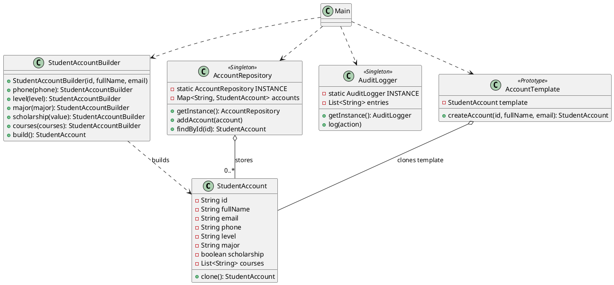

# UniAccounts – Work 1

Java implementation of the first assignment using three creational design patterns:
- **Builder** – `StudentAccountBuilder` creates accounts using required and optional fields.
- **Singleton** – `AccountRepository` and `AuditLogger` each have one shared instance.
- **Prototype** – `AccountTemplate` clones a prepared account template for a student batch.

## Requirements
- JDK 11 or newer.
- No external libraries.

## Compile
From the project root:

```bash
mkdir -p out
javac -d out $(find src -name "*.java")
```

## Run

```bash
java -cp out uniaccounts.Main
```

## StudentAccount fields

| Field | Required? | Default / validation |
|---|---|---|
| id | Yes | Non-empty and unique in repository |
| fullName | Yes | Non-empty |
| email | Yes | Must contain `@` |
| phone | No | `null` |
| level | No | `L1`; allowed: L1, L2, L3, M1, M2 |
| major | No | `null` |
| scholarship | No | `false` |
| courses | No | Empty list |

## UML (PlantUML)



## Design pattern explanations

### Builder
The Builder pattern is used in `StudentAccountBuilder`. It separates the construction of a student account from the account class. The three required values are supplied when the builder is created; optional values can be set through methods. Without Builder, a constructor with eight parameters would be harder to read and could cause parameter-order mistakes.

### Singleton
Singleton is used in `AccountRepository` and `AuditLogger`. Their constructors are private and their single instances are accessed through `getInstance()`. This ensures that the application uses one central repository and one audit log. Without Singleton, different parts of the application could create separate repositories and logs, splitting the data.

### Prototype
Prototype is used by `AccountTemplate` and `StudentAccount.clone()`. A prepared account template is cloned, then the new student's identity fields are changed. The courses list is copied independently. Without Prototype, the same batch details would need to be configured repeatedly for every student.

## Notes
- The repository checks ID uniqueness when an account is inserted.
- The Builder validates required fields, email format (presence of `@`), and the allowed level values.
- `courses` is defensively copied so cloned accounts do not share the same mutable list.
# UniAccounts
